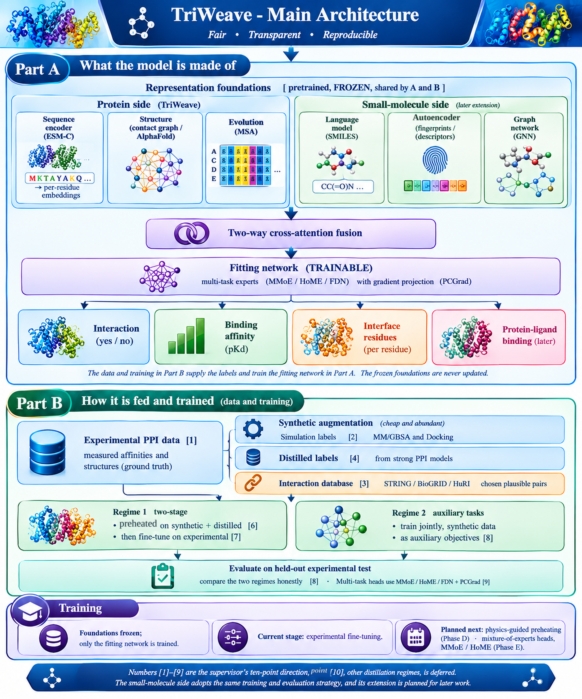

# TriWeave: Architecture and Research Roadmap

**Author:** Khalid Zaman, Research Assistant Professor (RAP).  **Supervisor:** Prof. Zhaoxi Sun, SUAT.
**Project:** TriWeave (repository: multimodal-ppi).  Last updated: 2026-10-26 (revision 2).

This document gathers the supervisor's guidance into one plan. Revision 2 folds in his detailed
ten-point direction, which sharpens the data and training strategy and confirms that the immediate
focus is the protein-protein interaction model. The protein-ligand drug-screening ideas are recorded
as a later extension.

## 1. Where the project stands today

TriWeave is a multimodal, multi-task model for protein-protein interaction. For each protein it reads
three views: the amino-acid sequence (ESM-C), the three-dimensional structure (a residue contact graph
from experimental complexes), and the evolutionary history (a multiple sequence alignment). A two-way
cross-attention layer lets the two proteins read each other, and three heads predict interaction,
binding affinity, and interface residues. On the leakage-free Bernett benchmark the interaction model
reaches AUROC 0.724 and AUPR 0.719, ahead of the released PLM-interact baseline, and the affinity and
interface results carry error bars over three seeds. This is a solid proof of concept and the
foundation the roadmap builds on.

## 2. Main architecture (confirmed), with data and training

Following the supervisor's meeting direction, the main architecture now shows two things in one
figure. Part A is what the model is made of, and Part B is how it is fed and trained.

In Part A, each input is encoded by powerful models that are pretrained once on large unlabelled data
and then kept frozen, used only as fixed feature extractors. On the protein side these are the sequence
encoder (ESM-C), the structure (a residue contact graph from an experimental or AlphaFold-predicted
structure), and the evolutionary features (from a multiple sequence alignment). The frozen features
feed a smaller trainable fitting network that carries the prediction heads. Freezing the foundations
keeps their general knowledge intact, avoids overfitting the large models to small datasets, and makes
the system modular, so later training stages slot into the fitting network without touching the
foundations. The model is protein-only, matching the supervisor's representation (ESM-C, structure,
and MSA); the small-molecule and protein-ligand screening direction is kept separate as the deferred
vision in Section 4.

Part B is the data and training strategy, set out in full in Section 3. It is the step the supervisor
asked to add inside the main architecture, so that one figure shows not only the model but also how the
scarce experimental data is enlarged and how the model is trained on it.

## 3. Data and training strategy (the supervisor's ten-point direction)

The central challenge is that experimental protein-protein interaction data, measured binding
affinities and structures, is scarce and covers few proteins. The plan addresses this by building a
large body of synthetic training data, using it to preheat the model, and then fine-tuning on the
experimental ground truth. This is Part B of the main architecture figure in Section 2, where the
numbers mark the ten points set out below.

### 3.1 Experimental foundation

A database of experimental PPI data: measured binding affinities, structures, and other fitting
targets. This is the ground truth the model is ultimately fine-tuned and evaluated on. The current
sources (PPB-Affinity pKd values, RCSB structures, interface labels, and the Bernett interaction
pairs) are to be consolidated and, where possible, extended.

### 3.2 Synthetic data augmentation

Two complementary and inexpensive sources of extra labels, both guided so they stay meaningful.

- **Simulation-derived.** Physical methods, MM/GBSA or docking scoring functions, compute approximate
  binding affinities for protein pairs. These are fast and abundant compared with experiment, and are
  the group's established strength.
- **Distilled from strong models.** State-of-the-art PPI predictors, the best models released by other
  groups, are run to predict pairwise binding strengths, and those predictions are used as training
  labels.
- **Guided pair selection.** Synthetic pairs are not drawn from all possible protein combinations,
  because most proteins do not interact. A reported-interaction database (for example STRING, BioGRID,
  or HuRI) is used to choose plausible interacting pairs, keeping the synthetic data sensible.

### 3.3 Training regimes (to be compared, not assumed)

- **Two-stage.** Preheat the fitting network on the synthetic and distilled data, then fine-tune on the
  experimental data.
- **Auxiliary tasks.** Alternatively, train on synthetic and experimental data together, with the
  synthetic data as auxiliary objectives beside the main ones.

The supervisor is explicit that it is not known in advance which regime wins, so both are to be built
and compared on the held-out experimental test set.

### 3.4 Multi-task machinery

The model carries several regression and classification tasks with very different sample sizes, so the
tasks can conflict (opposing gradients) and the large task can dominate. Two families of remedies
apply, and can be combined: mixture-of-experts architectures (MMoE and its variants HoME and FDN, the
feature-decomposition network), and gradient-surgery methods such as PCGrad, which projects conflicting
task gradients so they stop cancelling.

## 4. Longer-term vision (deferred)

Beyond the protein-protein model, the same frozen-foundation design extends to small molecules (the
group's three molecule foundation models) for protein-ligand binding and virtual screening, with model
distillation and hierarchical screening for scale. The supervisor has placed this, and other
distillation regimes, in a later discussion. It is recorded here as the destination, not the immediate
work.

## 5. Phased roadmap

- **Phase A (complete).** TriWeave protein model. Interaction, affinity, and interface, on ESM-C.
- **Phase B (freeze test done; capacity follow-up running).** Frozen representation foundations and
  AlphaFold-predicted structures for coverage. The freeze-versus-fine-tune experiment is done: with the
  ESM-C backbone frozen and only the 1.35M-parameter fitting network trained, the model ties the
  fine-tuned model on interface (AUPR 0.300 vs 0.298) and trails it modestly on affinity (Pearson 0.408
  vs 0.441), training 0.2% of the parameters on a small GPU. Freezing is adopted, as the staged design
  requires; the small affinity gap is a target for fitting-network capacity (a wider-network follow-up is
  running) and for the preheating stage. See `reports/PHASE_B_FREEZE_VS_FINETUNE.md`.
- **Phase C.** The data engine. Consolidate the experimental database, choose the interaction database
  that guides pair selection, and generate synthetic labels from simulation (MM/GBSA or docking) and
  from distillation of strong PPI models.
- **Phase D.** Staged training. Preheat the fitting network on the synthetic and distilled data,
  fine-tune on experimental data, and compare this against the auxiliary-task regime.
- **Phase E.** Multi-task machinery. Add a mixture-of-experts design (MMoE / HoME / FDN) and / or
  gradient projection (PCGrad), and measure the reduction in task conflict.
- **Phase F (later).** Protein-ligand binding and virtual screening, per Section 4.

## 6. Open decisions

- Freeze or fine-tune the backbone (Phase B). Resolved in favour of freezing (small affinity cost, tied
  interface); a wider-fitting-network follow-up is testing whether the affinity gap closes, and the
  decision is to be confirmed with the supervisor.
- Two-stage pretraining versus auxiliary tasks (Phase D), to be decided by experiment.
- Data choices: which experimental databases to consolidate, which interaction database guides pair
  selection, which state-of-the-art models to distil from, and whether MM/GBSA or docking (or both)
  generates the simulation data, and at what scale.
- Multi-task method: mixture-of-experts, gradient projection, or a combination.

## References

1. Wang, X. et al. HoME: Hierarchy of Multi-gate Experts for Multi-Task Learning at Kuaishou. KDD 2025.
2. Feature Decomposition for Reducing Negative Transfer: A Novel Multi-task Learning Method for Recommender System.
3. Yu, T. et al. Gradient Surgery for Multi-Task Learning (PCGrad). NeurIPS 2020.
4. Szklarczyk, D. et al. The STRING database. Nucleic Acids Research (reported protein-protein interactions).
5. Zhang, Z. et al. Fitness aligned structural modeling enables scalable virtual screening with AuroBind. arXiv:2508.02137 (2025).
6. Liu, D. et al. PLM-interact: extending protein language models to predict protein-protein interactions. Nat. Commun. 16, 9012 (2025).
7. Bernett, J., Blumenthal, D. & List, M. Briefings in Bioinformatics 25, bbae076 (2024).
